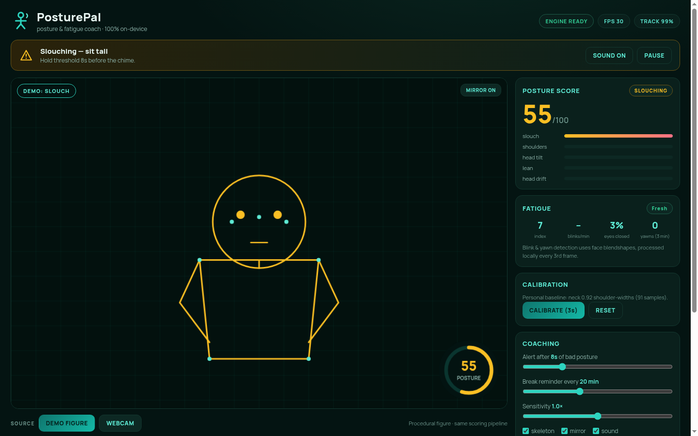
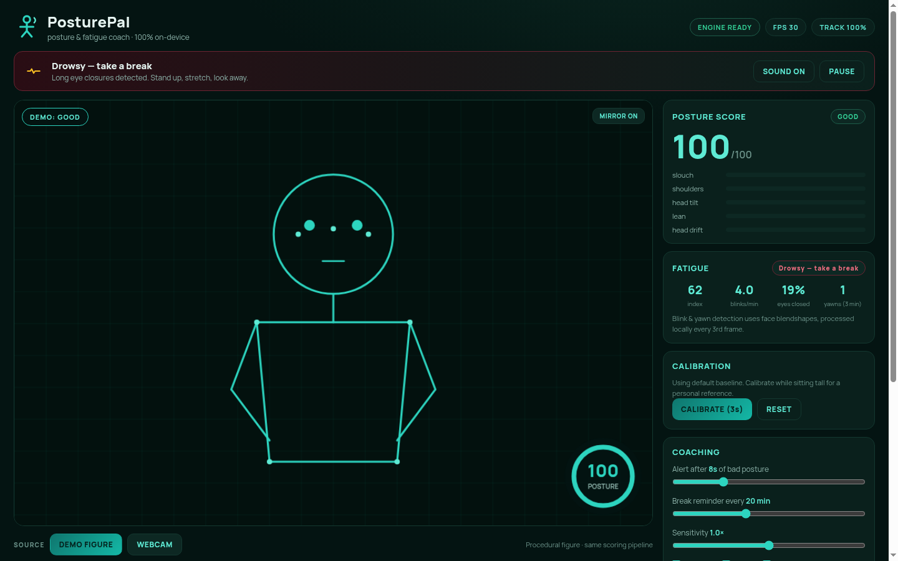
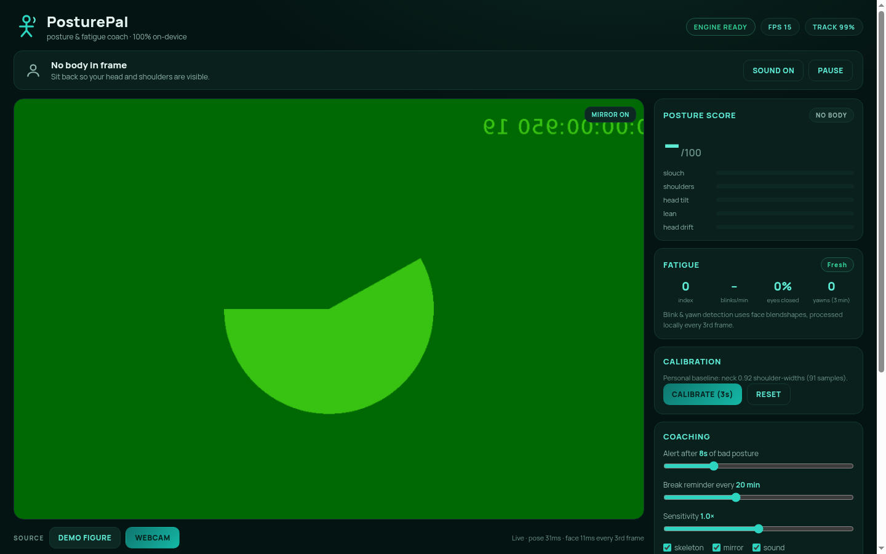

# PosturePal — Posture & Fatigue Webcam Coach

**Sit tall, stay fresh.** PosturePal watches your posture through the webcam and coaches you
gently: slouch, shoulder tilt, head tilt, leaning and head-drift detection, plus a fatigue
index built from your blink and yawn patterns. Two MediaPipe models, five geometry metrics,
zero cloud — no video ever leaves the page.

The only permission is `storage` (your tuning and calibration baseline).



---

## How posture scoring works

A pose model (PoseLandmarker lite) locates your nose, ears, shoulders and hips. Every metric
is normalized by **shoulder width**, so sitting closer or farther from the camera doesn't
change your score:

| Metric | What it measures | Penalty cap |
|---|---|---|
| Slouch | nose→shoulder vertical distance vs your calibrated baseline (neck "shortens" as you slump) | 45 |
| Shoulders | shoulder-line angle from horizontal (deadband 4°) | 25 |
| Head tilt | ear-line roll angle (deadband 6°) | 28 |
| Lean | shoulder-centre vs hip-centre horizontal offset (deadband 0.12 widths) | 25 |
| Head drift | nose horizontal offset vs baseline (deadband 0.10 widths) | 25 |

Score = 100 − penalties (each capped, scaled by your sensitivity slider). The largest
penalty names the state: SLOUCHING, SHOULDER TILT, HEAD TILT, LEANING, HEAD FORWARD.
A 4-frame stability filter prevents flicker, and the displayed score is EMA-smoothed.

**Calibration.** Sit tall and press CALIBRATE — 3 seconds of samples become your personal
neck-length and head-offset baseline, persisted locally. Without it, a sensible default is
used. Reset anytime.

## How fatigue tracking works

A face model (FaceLandmarker with blendshapes) runs every 3rd frame and outputs
`eyeBlinkLeft/Right` and `jawOpen`:

- **Blink**: eyes closed (mean blendshape > 0.5) for 60–500 ms → one blink.
- **PERCLOS**: time-weighted fraction of the last 60 s with eyes closed. Long closures
  (> 500 ms) aren't blinks — they're drowsiness. PERCLOS ≳ 0.15 is treated as impaired in
  drowsiness research; the index maps 0.23 → 60.
- **Yawn**: `jawOpen` > 0.6 sustained ≥ 800 ms → one yawn per episode.
- **Low blink rate**: below ~10/min after 30 s of data adds a screen-strain term.

Fatigue index 0–100: FRESH (< 30) → MILD (30–60) → DROWSY (> 60). All windows are
**time-weighted**, so background-tab frame throttling doesn't skew the rates.

## Coaching

- Bad posture held past your alert threshold (4–20 s, default 8 s) → gentle chime + alert.
  One alert per bad episode; recovery requires 2 s of good posture.
- Break reminders follow **20-20-20**: every N minutes (5–45, default 20) of tracked time,
  look 20 feet away for 20 seconds.
- Drowsiness warning when the fatigue index crosses into DROWSY.
- Session timeline (posture + fatigue), good-posture %, tracked time, alert/break/blink/yawn
  counters, event log, and a JSON session report.

## Demo mode — a procedural seated figure

No camera? A synthetic figure runs a 27-second scripted cycle — GOOD → SLOUCH → HEAD TILT →
LEAN → FATIGUE (long eye closures + a yawn) — through the **same** scoring and fatigue
pipeline as the webcam. Ground-truth badges show what the figure is doing so you can watch
the score react.



## Webcam mode

960×640, mirrored by default. Pose every frame (~25 ms CPU), face every 3rd frame (~15 ms) —
~15–30 fps on a typical laptop. Frames are drawn to canvas with a skeleton overlay and a
live score ring; nothing is recorded or uploaded.



## Privacy

- Both models and WASM are vendored — **zero network calls** at runtime.
- No analytics, no telemetry, no accounts, no video storage.
- `storage` keeps only tuning sliders and your calibration baseline.

## Honest limits

- Front-facing seated pose only. Side profiles, standing desks, or shoulders out of frame
  degrade or disable scoring (NO BODY state).
- Fatigue is a **heuristic wellness hint**, not a medical measurement. Glasses, low light
  and extreme head angles affect blink blendshapes.
- One person at a time (`numPoses: 1`, `numFaces: 1`).
- CPU delegate for compatibility; two models share the frame budget (face runs every 3rd
  frame by design).
- Background tabs are throttled to ~1 Hz by Chrome; time-weighted windows keep rates
  honest, but coaching reacts slower while the tab is hidden.

## Install (unpacked)

1. Clone or download this folder.
2. `chrome://extensions` → Developer mode → **Load unpacked** → select the folder.
3. Click the toolbar icon. Try the demo, then switch to webcam and calibrate sitting tall.

## Test harness

Real Chromium (headful under `xvfb-run`) + puppeteer-core, extension loaded via
`--load-extension`, fake camera via `--use-fake-device-for-media-stream`. Latest run — all green:

| Check | Result |
|---|---|
| Both engines init (pose + face WASM, CPU) | ready, no errors |
| Demo cycle classification | GOOD 100, SLOUCH 55, HEAD TILT 72, LEAN 75, FATIGUE 100 — all states correct |
| Offline calibration (dt 33/40/50 ms) | identical states, 1 alert/cycle, fatigue 66–67 DROWSY |
| Fatigue | 1 yawn, blinks counted, PERCLOS 0.21, DROWSY reached |
| Posture alert | 1 per bad episode, recovery logged |
| Calibration | baseline neck 0.92 widths, 91 samples, persisted |
| Tuning | alert 4 s + sensitivity 1.3× applied, reset works |
| Break reminder | fires at threshold, counter increments |
| Pause | frame counter frozen, veil shown |
| Webcam pipeline | 15 fps, pose ~23 ms, face ~11 ms, correct NO BODY on test pattern |
| Log / report / help | pass |
| Mobile 390 px | scrollWidth 390 = innerWidth, no overflow |
| Console errors | none |

## Repo layout

```
manifest.json      MV3, storage-only, wasm-unsafe-eval CSP
background.js      toolbar click → app tab
app.html           full-tab coach UI
css/app.css        teal wellness theme, Manrope (bundled woff2)
js/metrics.js      pure posture geometry + FatigueTracker (blink/PERCLOS/yawn)
js/engine.js       PoseLandmarker + FaceLandmarker wrappers (CPU, VIDEO)
js/demo.js         procedural seated figure + 27 s scripted cycle
js/sources.js      webcam source
js/audio.js        soft WebAudio chimes
js/app.js          orchestration, coaching, calibration, timeline, report
vendor/            tasks-vision bundle, WASM, pose + face models
icons/ docs/ promo/
```

## Promo kit

| Asset | File |
|---|---|
| Logo | `promo/logo.png` |
| Software box | `promo/software-box.png` |
| Poster | `promo/poster.png` |
| Banner | `promo/banner.png` |
| Video (8 s, 1080p) | `promo/promo.mp4` |

## Credits & licenses

- Code: MIT (see `LICENSE`).
- [MediaPipe Tasks Vision](https://github.com/google-ai-edge/mediapipe) (bundle + WASM): Apache-2.0.
- Pose Landmarker (lite) and Face Landmarker models: Apache-2.0, Google.
- [Manrope](https://fonts.google.com/specimen/Manrope) font: SIL OFL 1.1.
- The demo figure is procedurally generated; no real person appears in any asset.